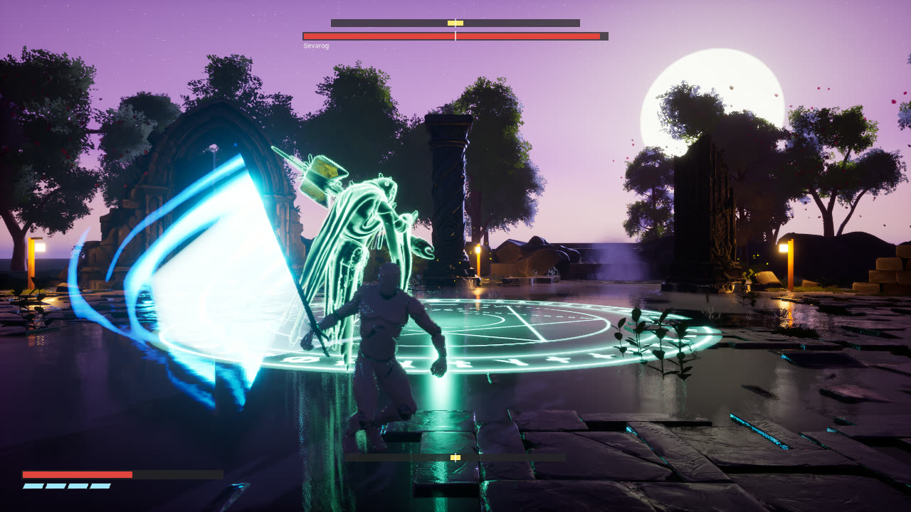
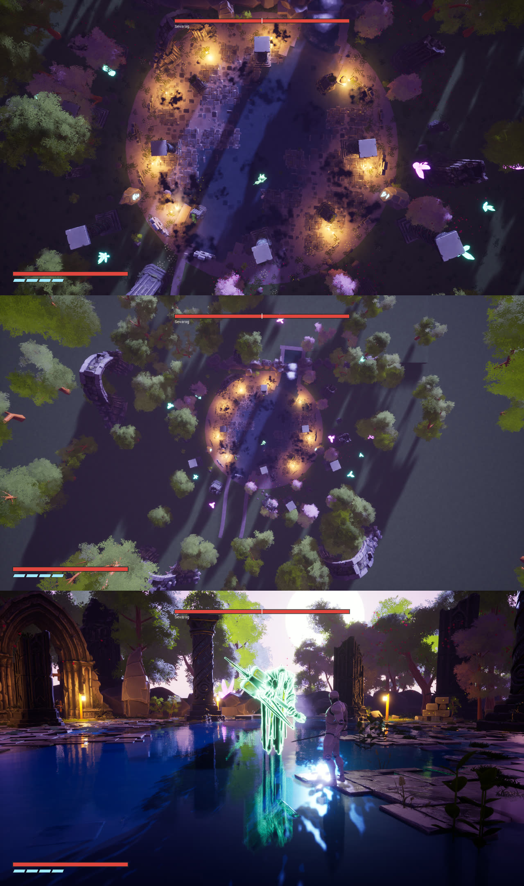
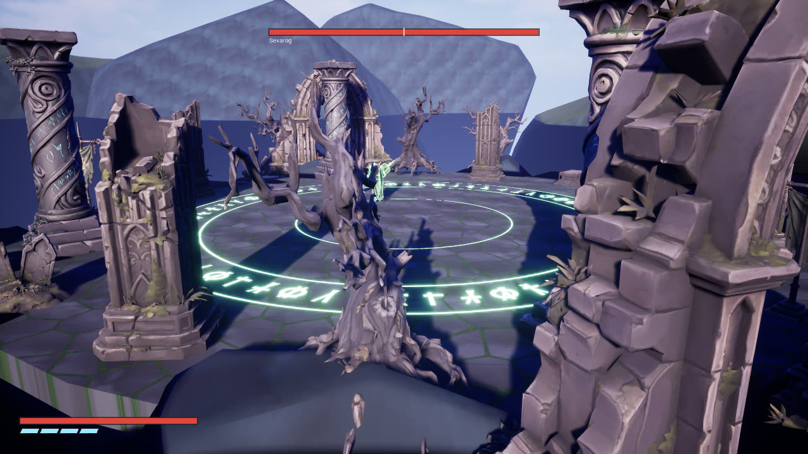
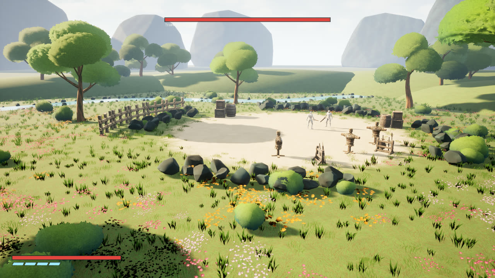
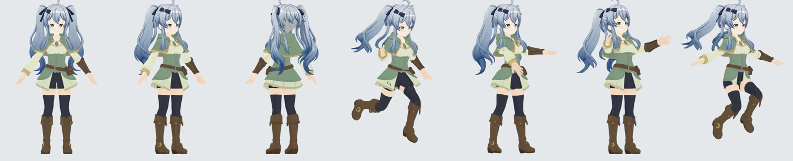

# Code.2 Pure Horizon

**A medieval-fantasy open-world action MMORPG, built in Unreal Engine 5.8 (C++). Work in progress.**

Personal project by **Eka Putra Meravigliosi** ([@EkaPutra0856](https://github.com/EkaPutra0856)): level design, gameplay programming, and a character pipeline.



> This repository holds the **source code, configuration, and build and pipeline scripts** only.
> Third-party art, animation, VFX, and audio packs (Epic Paragon, Fab/Marketplace packs) are **not** included, because their licenses do not allow redistribution.
> To open the project, add those packs from your own Fab library. See [Third-party content](#third-party-content).
>
> The boss shown in the screenshots and media is **Sevarog from Epic Games' Paragon assets** (free under the Unreal Engine EULA). The player in these shots is a placeholder mannequin.

---

## Media

| | |
|---|---|
| Boss fight: renders, clips, contact sheets | [Google Drive: Boss folder](https://drive.google.com/drive/folders/1UxyxRKzxWrxBtZNv4e6YDfZxATk2dML8) |
| Original character renders | [Google Drive: character renders](https://drive.google.com/drive/folders/1aFedAD7ioffriDW5WfA4AOJnTwVdhrH9) |

---

## Vision

Code.2 Pure Horizon is an open-world fantasy MMORPG with a stylized anime look. It is built in vertical slices. The first slice in this repository is **BossFight**, a Souls-like melee module. It has a boss arena and a training ground, and it is the combat core that the open world will use.

---

## Level design

### Boss arena: `L_Arena`, the twilight flooded temple


- **Sized to the boss's attack ranges.** The playable court is a 20 m radius disc (`ARENA_R = 2000`).
  - Sevarog's melee reaches 2.6 to 4 m, and his ground-wave sweep reaches 9 m.
  - He casts spells only when the player is between 4.5 and 17 m away.
  - The circle spell chases the player on a 7 m leash.
  - So the court is wide enough to dodge every spell, but there is no corner far enough away to cancel his kit.
- **Readable combat space.** The court is round, with eight pillars on a 17 m ring. The pillars give cover from spells and block the camera, so the spell camera sweeps for a clear line of sight around them.
- **Edges that keep the fight going.** The plateau has a lip. Rolls stop at the edge instead of falling off, and a player who is flung over it returns to the last safe ground. An invisible barrier ring at 29 m frames the dressed area.
- **Environmental storytelling.** A shallow river runs through the court as a live Fluid Flux simulation. Under the water is a glowing rune circle. Around the court stand ruined pillars, a collapsed temple gate, waterfalls, cherry trees, lanterns, and fireflies. Water splashes only on run, land, and hit, so it stays readable.
- **Built from concept to level by script.** Concept images go through a Python level-builder (`BossFight/Scripts/41`, `43`, `45`). Gameplay blockout and dressing are kept apart. All dressing actors are labelled `Env_` and rebuilt on every run, so collision and AI never change by accident.

Earlier daylight pass of the same court (rune circle and pillar ring):



### Training ground: `L_Training`


- A worn dirt clearing in a 45 m flowery meadow. It has scarecrow dummies, weapon racks, ruined walls, and a stream.
- The training dummy uses the same enemy AI as the boss, with a round-robin attack pick, so every parry and dodge rule can be practised on it.
- An invisible ring wall keeps the player inside the dressed area.

### Open world (planned)
The first open-world region is in planning. It will reuse the combat core from this module.

---

## Gameplay programming (C++, UE 5.8)

About 17,000 lines across 3 modules: `BossFight` (runtime), `BossFightAnimGraph` (uncooked-only), and `BossFightEditor` (editor tools).

**Player (`BFPlayerCharacter`)**
- **Sword combat.** Tap for a light attack, hold for a heavy. There is a ground combo, an air combo, and an air plunge.
- **Parry.** A perfect parry knocks back minions. Against heavy attacks it starts a **strength clash**: the player mashes a button against a timer bar, and a win breaks posture.
- **Dodge.** Directional slide-dash with charges. A perfect dodge gives screen shake and a refund, and dodging a grab starts a clash. A blink-dash teleports behind the enemy, and a gap-closer blink teleports to his near side.
- **Camera.** Lock-on with strafing. A spell camera zooms out to frame both the boss and the player. The camera handles walls and hides the player's body when it gets too close.
- **Hit feedback.** Hit-stop, hit flash, directional hit reactions, knockdown and get-up. A procedural sword smear (`BFSmearTrail`) and after-images.

**Boss (`BFBossSevarog`, `BFEnemyBase`)**
- **Data-driven attacks.** Each attack sets its range, hit window, chain-next, delay or feint holds, and warp lunges.
- **Movement.** The boss turns in place, backsteps, and leans its body toward where it travels. Posture or stance breaks lead to a critical.
- **Two spells.** A fire line, and a chasing circle that warns the player first.
- **Phase 2.** A three-shot cinematic with arc-lerped camera blends, a roar knockback, and an aura shell.
- **Death.** The body settles onto the ground, then dissolves into particles.
- **Custom anim-graph node (`FAnimNode_BFClothSway`).** A verlet particle chain for each robe strip, with substep-safe velocity and colliders.

**Tooling and automated testing**
- `UBFEditorTools` builds the AnimBlueprints and assets from code.
- About 50 numbered editor-Python scripts build the levels, materials, and FX from scratch.
- **Headless autotests.** Run `UnrealEditor.exe BossFight.uproject <map> -game -BFAutoTest=<mode>`. There are more than 20 modes, including `combat`, `parry`, `struggle`, `dodge`, `magic`, `phase2`, `ledge`, and `camwall`. The tests drive the game, log `BFTEST` assertions, and save screenshot contact sheets.
- `BossFight/Scripts/autotest/regress.sh` runs every mode on both maps.
- The Shipping cook uses a hard-reference manifest (`DA_CookManifest`).

---

## Character pipeline

Original anime-style characters, from concept to an Unreal Engine skeletal mesh:

1. **Concept.** Image generation and reference sheets (concept art only; not shipped as game assets).
2. **Base body.** VRoid, then Blender, through scripted import, measuring, and rigging (`CharacterPipeline/scripts/01..13`).
3. **Modular outfit and hair.** Tripo3D generates the parts. Python scripts in Blender then fit, weld, and trim them, and add twin-tail hair strand chains with baked verlet physics (`CharacterPipeline/swordswoman/scripts`).
4. **Detail rig.** A J_Bip skeleton, facial expressions (blink, joy, angry, sorrow, and more), and cloth and hair chains with collision checks (`CharacterPipeline/char4/rig/scripts/01..07`).
5. **UE import.** Scripted import of FBX, animations, physics assets, and face materials (`CharacterPipeline/char4/ue/13..17`, `CharacterPipeline/scripts/ue`).



More renders: [Google Drive: character renders](https://drive.google.com/drive/folders/1aFedAD7ioffriDW5WfA4AOJnTwVdhrH9)

---

## Repository layout

```
BossFight/
  BossFight.uproject
  Source/            C++: BossFight, BossFightAnimGraph, BossFightEditor
  Config/            Default*.ini
  Scripts/           editor-Python level/asset builders, autotest and poster runners
CharacterPipeline/
  scripts/           VRoid/Blender character scripts, Blender bridge, UE import (ue/)
  swordswoman/       outfit, Tripo fitting and UE import scripts
  char4/             rig pipeline 01-07 (rig/scripts) + UE import (ue/)
docs/img/            README screenshots
```

## Building

1. Install Unreal Engine 5.8 and Visual Studio 2022 with the C++ game workload.
2. Add the third-party packs listed below from your own Fab library.
3. Right-click `BossFight.uproject`, choose **Generate Visual Studio project files**, then build `BossFightEditor` (Development Editor, Win64).
4. Run the asset and level builders in `BossFight/Scripts/` (see the header of each script), then open `L_Arena` or `L_Training`.

### Script configuration

- Python scripts read the project root from the `ANIME_GAME_ROOT` environment variable (the folder that holds `BossFight/`, `scripts/`, `char4/`, `swordswoman/`). It defaults to the current directory.
- Shell runners (`BossFight/Scripts/autotest/run.sh`, `BossFight/Scripts/Poster/run_poster.sh`) need `UE_ROOT` set to the Unreal Engine install folder.
- `CharacterPipeline/scripts/run.ps1` uses `ANIME_GAME_BRIDGE`, or the `_bridge` folder next to the script.

## Third-party content

These packs are referenced but **not distributed**. Each one is licensed to its owner through Fab or the Unreal Engine EULA:
Paragon: Sevarog, Paragon: Greystone (Epic Games), Fantasy Bundle, LUSH Stylized Environment Set, Dreamscape Series, Fluid Flux, MagicKit, Hack & Slash FX, Slash Hit VFX, Baltic VFX Magic Circles, Insane Air Combo, Lucy, Ice Skill Pack 2, Mage Animation Set, and the sound packs.

## Status

Work in progress. Playable now: the boss arena and the training ground. Next: integrating the original characters as the player, then the first open-world region.

## Contact

Eka Putra Meravigliosi · GitHub [@EkaPutra0856](https://github.com/EkaPutra0856)
